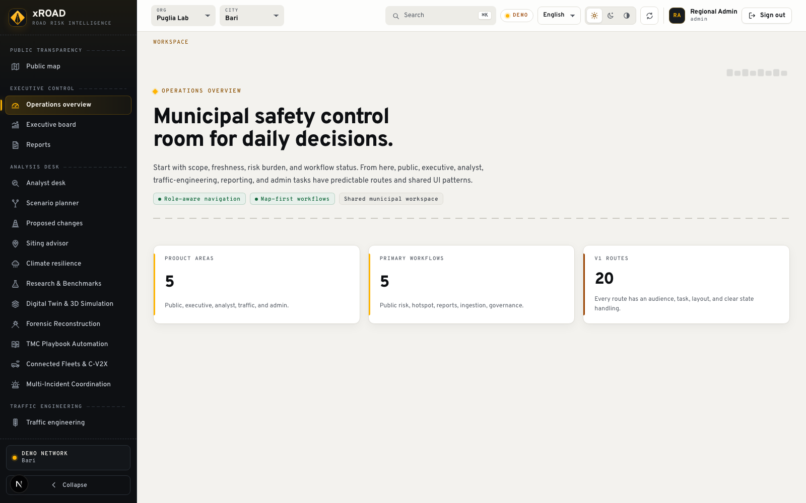
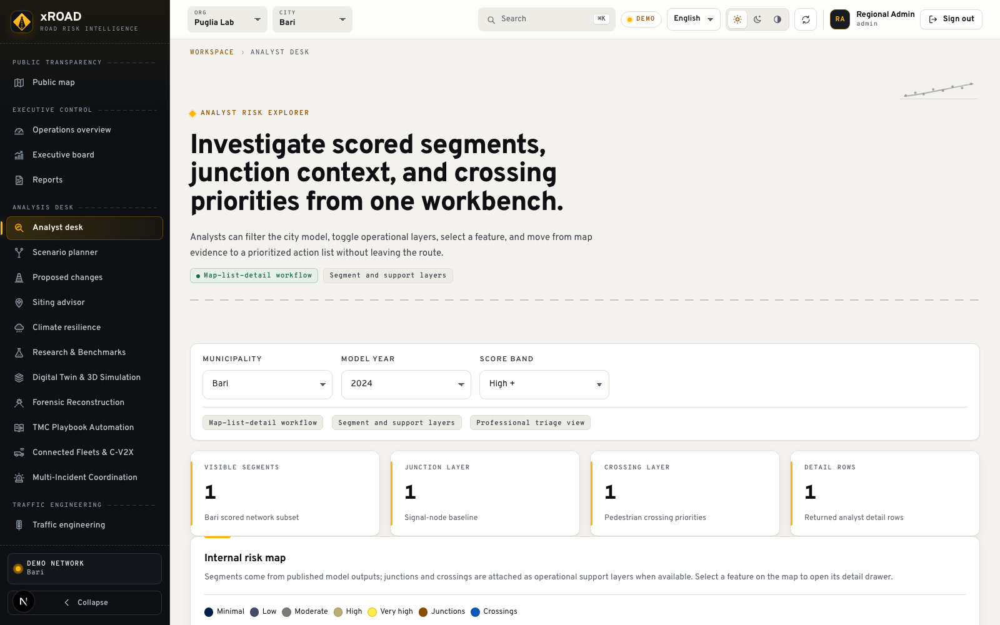

# xROAD

A road safety workspace for mapping crash hotspots, comparing risk, and planning interventions.

[Open the demo](https://kokutbon.github.io/xROAD/) · [Technical documentation](docs/)

## Features

- Explore road risk and accident hotspots on a map.
- Compare areas and evaluate prediction models.
- Review findings in analyst and municipal workspaces.

## Screenshots





## Technology

Python, FastAPI, Next.js / React, TypeScript, geospatial analytics.

## Run the demo locally

```sh
git clone https://github.com/KOKUTBON/xROAD.git
cd xROAD
cd apps/web
npm ci
npm run build:demo
npm run preview:demo
```

Open http://127.0.0.1:4173/xROAD/. The browser demo uses sample data. See the technical documentation for the full application setup.

## License

[Apache License 2.0](LICENSE).
