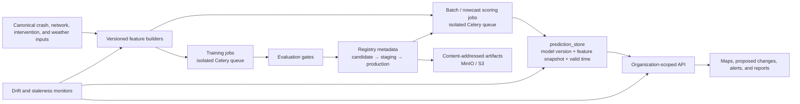

# ADR: ML training and serving architecture

**Status:** Accepted

**Date:** 2026-07-04

**Decision owners:** platform engineering and model governance

## Context

The platform now trains frequency, recommendation, siting, and
weather-conditioned models. It already has PostGIS serving, S3-compatible
object storage, lineage manifests, a Redis/Celery worker family, local
evaluation gates, and organization-scoped API access. The architecture must
make those models reproducible and promotable without adding an operations
stack that is disproportionate to municipal refresh cadence.

## Decision summary

Adopt batch-first inference with `prediction_store` as the serving contract,
the existing Python statistical/ML stack, the lightweight MLOps registry over
content-addressed object storage, one shared feature builder per model family,
and isolated queues on the existing worker fleet. Use shared transferable
models with city calibration layers by default. Fail closed through explicit
staleness, drift, and degradation policies. GPU infrastructure and a separate
online inference service are out of scope for v1.

The arrows are contracts, not direct filesystem coupling. Training and scoring
use the same feature-builder package; scoring resolves a registry stage and
writes versioned rows. The API reads prediction records and does not load
arbitrary model paths.

## 1. Serving pattern: batch first

**Decision.** Score durable segment/time-window outputs into
`prediction_store`. The minimum row identity is organization or jurisdiction,
spatial object, model name/version, feature-snapshot hash, prediction valid
time, generated time, score/band, and uncertainty. API and report consumers
read this contract.

This matches annual/quarterly municipal planning, makes map and report reads
cheap, preserves exactly what an analyst saw, and isolates API availability
from model runtime. Operational weather risk remains batch inference at an hourly nowcast cadence:
the scheduler materializes the next 72 hours atomically.

An online inference service is justified only when a measured requirement
cannot meet its freshness SLO through scheduled micro-batches—for example,
request-specific features changing faster than five minutes, interactive
what-if latency below one second, or input volume that makes materialization
prohibitively large. That change requires a new ADR, load evidence, feature
parity tests, and an operational fallback to the last valid batch.

## 2. Training and serving stack

**Decision.** Standardize on Python, scikit-learn, supported gradient boosting,
and statsmodels or PyMC where hierarchical partial pooling is materially
useful. Package preprocessing and estimator together in one serializable
pipeline. Use seeded CPU training and pin dependency versions in the recorded
environment.

These libraries cover tabular count, classification, ranking, calibration, and
hierarchical municipal models while remaining auditable and reproducible.
PyTorch/TensorFlow, distributed training, feature-serving infrastructure, and
GPUs add no demonstrated value for v1 and are explicitly out of scope.
Reconsider only with benchmark evidence that the accepted stack cannot meet a
documented quality or runtime requirement.

## 3. Registry and artifact storage

**Decision.** Extend the file/manifest MLOps registry. Store immutable model and
evaluation artifacts under SHA-256 keys in MinIO/S3; store small registry
metadata transactionally in the deployment's durable storage. Do not add an
MLflow container now.

The current registry already records parameters, metrics, data lineage, git
SHA, environment, model cards, stages, evaluations, and waiver events. MLflow
would duplicate those contracts and introduce a database, service, upgrades,
authentication, and tenancy policy before experiment volume requires them.

Reconsider MLflow or another registry when concurrent writers require stronger
transactions, model search/comparison becomes an everyday multi-team need, or
the lightweight metadata exceeds operationally manageable size. Migration must
preserve run IDs, hashes, stage history, model cards, and waiver audit records;
serving continues to depend on stage resolution rather than vendor APIs.

## 4. Feature source and skew prevention

**Decision.** Each model family owns one deterministic feature-builder
function and versioned schema. The intervention feature store is the reference shape: the same builder
constructs training matrices and batch-scoring rows. Notebooks may inspect its
outputs but may not reimplement production transformations.

Every run records builder version, input artifact hashes, schema, time cutoff,
and feature snapshot hash. Promotion gates reject schema incompatibility,
future leakage, or a scoring fixture that differs from the training builder.
Dynamic weather features are joined at an explicit observation/forecast valid
time; static network features are pinned to their snapshot.

## 5. Worker topology and resource isolation

**Decision.** Use the existing Redis-backed Celery worker/scheduler, adding
logical `road_risk_ml_training` and `road_risk_ml_scoring` queues. Deploy queue
consumers separately from ingestion, published refresh, and report workers.

Training workers receive low concurrency, CPU/memory limits, task time limits,
and no report queue. Hourly weather scoring receives a dedicated consumer and
higher scheduling priority. Celery Beat remains singleton and enqueues work;
it never trains inline. Production may use separate node pools, but not a
second broker until measured queue isolation or security requirements demand
it. This prevents a training run from starving report generation while
retaining one observable job system.

## 6. Multi-tenancy and calibration

**Decision.** Registry stages are scoped by model family and deployment
environment, while prediction rows and calibration artifacts are scoped by
organization/jurisdiction. Prefer one shared transferable base model plus a
versioned per-city calibration layer where transferability gates pass.

A city receives a separate full model only when its governed data, feature
schema, legal boundary, or measured transferability failure requires one.
Stage resolution therefore uses `(model_name, environment)` for the base and
selects an organization-authorized calibration artifact. It must never infer
tenant scope from a client-supplied file path. Global promotion cannot silently
replace a city calibration; both versions are recorded in prediction lineage.

## 7. Failure modes and graceful degradation

The scoring job and API expose freshness and evidence state, not merely a
numeric score.

| Failure | Detection | Required behavior |
|---|---|---|
| Stale model | Model age or training-data cutoff exceeds suite/model-card SLO | Block new promotion; continue last valid predictions with `stale_model` notice until policy expiry |
| Stale prediction | `generated_at` or forecast issue time exceeds product SLO | Suppress weather alert delivery; label or withdraw stale surface |
| Data drift | Ingestion compares schema, missingness, ranges, categorical novelty, and selected distribution statistics with the training snapshot | Quarantine incompatible input; warn and evaluate bounded drift; retrain only through normal gates |
| Missing/corrupt artifact | Registry checksum or stage resolution fails | Do not load; retain last verified materialized prediction if still valid |
| Model or gate failure | Training, scoring, or evaluation-gate suite fails | Keep current production stage; emit an actionable job/audit record |
| Tenant calibration unavailable | Calibration cannot be resolved for the authorized city | Use the validated shared model only when its transferability suite allows it; otherwise degrade |

The ordered evidence fallback is:

1. promoted trained model with valid calibration;
2. governed CMF/evidence prior;
3. documented deterministic heuristic;
4. no score, with an explicit unavailable/degraded notice.

Fallback level, reason, source version, and timestamp travel with every output.
The system never presents a fallback as a trained prediction and never turns
missing evidence into zero risk.

## Consequences

- Model serving remains simple, replayable, and resilient to API/model-process
  failures, at the cost of bounded freshness and additional materialized data.
- The repository avoids a premature ML platform service, but owns the
  lightweight registry's concurrency, backup, and migration discipline.
- Shared models reduce sparse-city overfitting; calibration and transferability
  gates become mandatory operational artifacts.
- Queue isolation needs deployment configuration and monitoring even though it
  uses the existing broker and worker image.
- Online inference, GPU training, a formal feature-store service, and MLflow
  remain possible later changes with explicit evidence-based triggers.

## Implementation references

- [MLOps registry and training workflow](mlops-workflow.md)
- [Evaluation and promotion gates](model-evaluation-gates.md)
- [Recommendation model and Proposed Changes contract](recommendation-model-card.md)
- [Core target architecture](architecture.md)
- [Production services and worker topology](../services/README.md)
