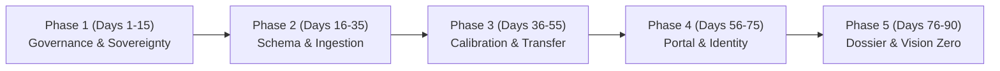

# Institutional Pilot Playbook: 90-Day Cross-Border Implementation

This playbook guides international transport ministries, national road safety agencies, police departments, and municipal councils through a structured **90-day pilot implementation** of the white-label **xROAD** platform.

---

## 1. 90-Day Implementation Roadmap



| Phase | Duration | Core Objective | Key Deliverables |
| :--- | :--- | :--- | :--- |
| **Phase 1: Governance & Topology** | Days 1–15 | Regulatory alignment and sovereign architecture selection | • Topology selection (Model A On-Premise vs. Model B Sovereign Cloud)<br>• Data license validation & ethics boundary agreement<br>• Initial `configs/tenant.toml` draft |
| **Phase 2: Ingestion & Geospatial** | Days 16–35 | Connect national crash records without code changes | • Declarative mapping schema (`mapping_config.json`)<br>• Coordinate Reference System (CRS) reprojection verification<br>• Initial canonical ingestion manifest |
| **Phase 3: Model Calibration** | Days 36–55 | Train, transfer, and validate predictive risk models | • Zero-shot geometric risk baseline<br>• Few-shot Bayesian calibration on local historical records<br>• Model evaluation scorecard & diagnostic gates |
| **Phase 4: White-Label Theming & SSO** | Days 56–75 | Institutional branding and enterprise access control | • Institutional branding injection (hex colors, logos, headers)<br>• Multi-language localization review<br>• Single Sign-On (SSO) integration (Keycloak / Azure AD) |
| **Phase 5: Decision Support & Sign-Off** | Days 76–90 | Deliver executive briefings and public safety outputs | • Sovereign Ministerial Safety Dossier (PDF & Markdown)<br>• High-risk corridor & black-spot prioritization list<br>• Vision Zero 5-year Capital Improvement Plan (CIP) |

---

## 2. Institutional RACI Matrix

| Activity | Ministry / Executive Sponsor | Safety Engineering & Analysts | IT / Sovereign Cloud DevOps | Police & Traffic Data Stewards |
| :--- | :---: | :---: | :---: | :---: |
| Topology & Data License Sign-Off | **Accountable** | Consulted | Responsible | Consulted |
| Crash Schema Crosswalk Definition | Informed | **Responsible** | Support | **Consulted** |
| Sovereign Container Deployment | Informed | Consulted | **Responsible** | Informed |
| Model Calibration & Evaluation Gates | Informed | **Responsible** | Support | Consulted |
| Portal Branding & Language Review | **Accountable** | Responsible | Support | Informed |
| Ministerial Safety Dossier Briefing | **Accountable** | **Responsible** | Informed | Informed |

---

## 3. Phase-by-Phase Execution Guide

### Phase 1: Governance, Topology & Configuration Setup (Days 1–15)
1. **Choose Deployment Topology**:
   - **Model A (Dedicated Sovereign Appliance)**: For national ministries, defense, or police where microdata must remain inside a sovereign perimeter.
   - **Model B (Multi-Tenant SaaS)**: For metropolitan areas or consortiums of cities sharing cloud infrastructure with Row-Level Security.
2. **Draft Institutional Configuration**:
   Create `configs/institution_pilot.toml` defining the institution's name, tier, country code, timezone, native projection (`EPSG` code), brand colors, and privacy thresholds.
3. **Run Readiness Audit**:
   ```bash
   python infra/scripts/bootstrap_institution.py --config configs/institution_pilot.toml --generate-env --generate-secrets
   ```

### Phase 2: Schema Mapping & Ingestion (Days 16–35)
1. **Define Declarative Crosswalk**:
   Map local crash fields (police accident reports, municipal exports) to the canonical schema using declarative JSON/TOML (e.g. following `configs/mapping_stats19_uk.example.json` or `configs/mapping_generic.example.toml`).
2. **Run Declarative Ingestion**:
   ```bash
   road-risk ingest-declarative \
     --csv-path /path/to/crashes_historical.csv \
     --mapping-config configs/mapping_pilot.json \
     --output-dir data/staging
   ```
3. **Verify Geospatial Alignment**:
   Confirm that re-projected coordinates match the target jurisdiction's road network using the generated manifest.

### Phase 3: Model Calibration & Transferability (Days 36–55)
1. **Evaluate Transferability Mode**:
   - **Cold-Start (Day 0)**: Deploy history-free baseline using road graph geometry, functional road classes, speed limits, and surrounding points of interest.
   - **Few-Shot Fine-Tuning**: Retrain foundational weights with 1–2 years of local crash data.
2. **Pass Model Quality Gates**:
   Audit calibration curves and Poisson deviance scores against [`docs/model-evaluation-gates.md`](model-evaluation-gates.md).

### Phase 4: White-Label Theming & Enterprise SSO (Days 56–75)
1. **Inject Institutional Tokens**:
   Verify that `apps/web` renders the agency's primary colors, official logo, and localized text.
2. **Configure Identity Provider**:
   Follow [institutional deployment](institutional-deployment-guide.md) to provision HTTPS, mounted secrets, and web/API OIDC settings. Connect Keycloak or Microsoft Entra ID to grant role-based access for safety analysts, city planners, and enforcement officers.

### Phase 5: Ministerial Briefing & Decision Support (Days 76–90)
1. **Compile Executive Dossier**:
   Generate an authoritative briefing briefing minister and mayor:
   ```bash
   PYTHONPATH=src python3 tools/institutional_onboarding_demo.py --config configs/institution_pilot.toml
   ```
2. **Review High-Risk Interventions**:
   Authorize infrastructure countermeasure shortlists and signal retiming interventions in the analyst dashboard.

---

## 4. Success Criteria & Pilot KPIs

| Dimension | Pilot KPI Target | Measurement Mechanism |
| :--- | :--- | :--- |
| **Pipeline Reproducibility** | 100% automated ingestion without custom Python coding | Declarative schema manifest |
| **Spatial Accuracy** | 0 coordinate datum distortions across national projections | Automated `pyproj` transformation audit |
| **Predictive Ranking** | Top 10% of high-risk corridors capture $\ge 60\%$ of future severe crashes | Temporal holdout evaluation gate |
| **Regulatory Trust** | Full conformity with EU AI Act high-risk requirements & GDPR | CE-conformity audit report & SHAP feature attributions |
| **Decision Velocity** | Time-to-briefing reduced from months to under 1 minute | Automated Ministerial Safety Dossier compiler |
